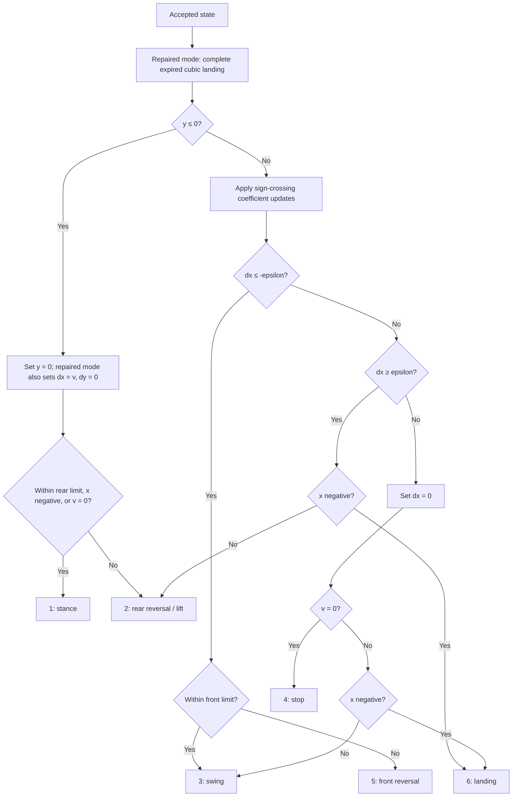

# From the paper to the program

Source: Konstantinov, Minakhin and Ponomarenko, *Проблемы кибернетики* 28 (1974), printed pp.193–209. [Original DjVu](https://etudes.ru/.data/localdocs/koshechka.djvu). Page numbers below are printed page numbers, not file-page indices. No scanned figures are redistributed here.

**Published** means stated in the paper. **Interpretation** means one implementation of an underspecified method. **Estimate** fills missing numerical data. **Repair** deliberately changes a printed rule to make our sampled solver usable. None of these labels implies the original machine executed our Python implementation.

## Coordinate and state map

`Leg.state = [x, y, dx, dy]` describes the endpoint of the **third** leg segment relative to its shoulder. Positive x points backwards, opposite travel. y is height above the floor; dx and dy are derivatives in model time. The visible toe belongs to segment four and has a separate position. In stance, dx equals body speed v, so the endpoint remains stationary in world coordinates.

`Leg.k[1]` through `[7]` are K₁…K₇. Index zero is intentionally unused to preserve the printed numbering. The stored previous dx detects reversals. Source-table values are in [article/data](article/data/); the core writes them explicitly and tests correspondence.

## Acceleration pairs — table 1, pp.205–206

All six pairs are implemented in [`derivative`](reconstruction/kitty/core.py). Named integer constants retain the printed branch numbers. Let ρ = √(x² + (h−y)²), and l be the sum of the first three segment lengths.

| Branch | x″ | y″ | Status |
|---|---|---|---|
| 1 — Stance | v′ | 0 | Published |
| 2 — Rear reversal / lift | −M₁x / abs(l−ρ) | M₂(h/8−y) | Published; denominator guard is a repair |
| 3 — Swing | −(π/K₂)v(1−Δφ/(2π))x | K₁x′ | Published; phase-fit convention is an interpretation |
| 4 — Stop | 0 | −K₃ | Published sign; default uses +K₃ to brake descent |
| 5 — Front reversal | −M₁x / abs(l−ρ) | K₁x′ | Published; denominator guard is a repair |
| 6 — Landing | K₄y′ + v′ | 6K₆(t−K₅) + 2K₇ | Published |

The default clip exercises 1, 2, 3, 5 and 6. Branch 4 is tested independently. In repaired selection, epsilon is zero and the `dx <= 0` branch wins at exactly zero; this also means the printed zero-band stop path is not selected. This behavior is deliberate and covered by the regression fixtures.

## Decisions and coefficient updates — table 2, p.206

[`select`](reconstruction/kitty/core.py) runs once per accepted step, before RK4 trial stages. Its events update coefficients; those coefficients, the branch and phase correction then stay fixed inside the step.

This is our independently drawn map of the implemented decisions. Literal mode uses the printed epsilon=0.001; repaired mode uses true sign crossings. Boundary order matters, including equality tests.

At a positive-to-nonpositive dx crossing (group I): K₁=y′/x, K₂=abs(x), K₃=(y′)²/(2y).

At a negative-to-nonnegative crossing (group II), T=abs(x)/(5M): K₃=(y′)²/(2y), K₄=−v/y, K₅=t, K₆=(y′T+2y)/T³, K₇=−(2y′T+3y)/T². These coefficients define a landing cubic with zero height and vertical speed at its end. Remembering its end time and explicitly completing touchdown are repairs, because a sampled integrator can miss its double root.

## Remaining algorithm map

| Paper | Code | Classification and practical meaning |
|---|---|---|
| Tables 3–5, pp.207–208 | [`initial_legs`, constants](reconstruction/kitty/core.py) | Published states and coefficients. KM1/KM2 are interpreted as M1/M2; the printed 5M inconsistency is retained. |
| Phase mapping and perpendicular-cross fit, pp.208–209 | [`phase_fit`, `phase_errors`](reconstruction/kitty/core.py) | Published mapping and leg order; squared chord distance, wrapping and degenerate-fit handling are interpretations. Negative error means lag. |
| Integration discussion, p.201 | [`step`](reconstruction/kitty/core.py) | RK4 is explicitly permitted; step size and event/stage semantics are our choices. |
| Figure 8 and constraints, pp.201–202 | [`solve_leg`](reconstruction/kitty/core.py) | Published α=d·y and β=c·γ. c is −1.2 rear / 0.8 front. Scalar root solver and negative bend choice are interpretations; lengths and d are estimates. |
| Tapered solids, pp.194–197 | [`solid`, `paper_rotation`](reconstruction/kitty/geometry.py) | Published primitive and orientation convention; no generic Euler-order substitution. |
| Hierarchy, pp.197–201 | [`Node`, `leaves`, `cat`](reconstruction/kitty/geometry.py) | Published relative-frame semantics and topology; only leaves draw. Numerical shape lists are estimated. |
| Projection and printing, pp.194,197 | [`projected`, `render`](reconstruction/kitty/render.py) | Published orthographic union and binary occupancy. Grid, glyph, view angle and display scale are estimates. |
| Body movement description, p.201 | [`speed`](reconstruction/kitty/core.py) | Initial speed is published; cruise/deceleration schedule is estimated. |
| Head movement description, p.193 | [`cat`](reconstruction/kitty/geometry.py) | Smooth 65° turn and its timing are estimated, independent of leg dynamics. |

## What the analysis panel shows

Trajectories and phase points represent the displayed sample. The fitted cross and error come from Python's shared `phase_fit`, not a second JavaScript simulation. Phase error modulates **branch 3 only**, and only when coupling is enabled. Branch labels describe the last integration interval; t=0 is labeled initial conditions. The phase geometry displayed after a step can differ slightly from the correction frozen at the beginning of that step.

For the full list of assumptions and known limitations, see [implementation notes](reconstruction/README.md). For further historical sources, see [research guide](RESEARCH.md).

## Additional verification

The [phase-fit study](PHASE-FIT.md) derives the chosen objective and compares alternatives. [Lean proofs](formal/README.md) establish selected real-number identities and minimization claims. The [C port](native/README.md) implements the same controller and rendering pipeline, with numerical parity checks. The [fidelity study](FIDELITY.md) changes only estimated shape/camera parameters in a named preset.
