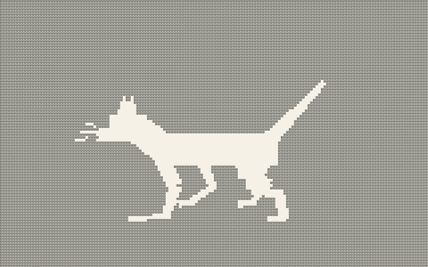

# Кошечка · Koshechka

Reconstructing the **1968 BESM-4 cat animation** from its published mathematics.

[Watch the original «Кошечка» on YouTube](https://www.youtube.com/watch?v=JWiWYqvP0BU) · [Historical background and paper](https://etudes.ru/etudes/cat-animation/)



Four legs driven by differential equations, a cat assembled from tapered solids, and binary printing with the Cyrillic letter **Ш**. This is an independently written reconstruction, not recovered historical source code or a frame-exact replica.

The motion and leg solver fit in [one small Python file](reconstruction/kitty/core.py). A [small streaming runner](reconstruction/minimal.py) advances the simulation and emits one frame at a time, without storing the movie. The viewer and export tools are separate from that core.

## Try it

**[Open the live viewer](https://ddanila.github.io/koshechka/)** — no installation needed. Expand “Explain the motion” for endpoint trajectories, the fitted phase cross and branch names synchronized with playback.

Clone the repository and open [reconstruction/index.html](reconstruction/index.html) in a browser. No server is required: the generated demonstration is bundled. Scrub through the motion, rotate the view, switch between Ш printing, silhouette and wireframe, or turn off camera tracking to see the cat cross the frame.

In the motion inspector, step by frame with the arrow buttons (or left/right keys when no control is focused), select a leg, or select an event marker. Marker times come from the accepted integration steps; lift-off is observed at the accepted endpoint.

You can also download the [close-up MP4](reconstruction/output/kitty.mp4) or [fixed-camera MP4](reconstruction/output/kitty-travel.mp4).

To generate it yourself, use Python 3.9+ and Pillow. Install FFmpeg separately for MP4 output.

```sh
git clone https://github.com/ddanila/koshechka.git
cd koshechka
python3 -m venv .venv
.venv/bin/python -m pip install -r requirements.txt
.venv/bin/python reconstruction/run.py
```

Use `--no-video` if FFmpeg is unavailable. The GIF and browser animation will still be generated.

For the small streaming path:

```sh
.venv/bin/python reconstruction/minimal.py | ffmpeg -y -f rawvideo -pixel_format rgb24 -video_size 960x600 -framerate 24 -i - -pix_fmt yuv420p kitty.mp4
```

## Further verification

The default **fitted** preset improves the estimated upper body and tail against reviewed computed-film samples; `--preset baseline` reproduces the earlier model. [Measurements and limitations](FIDELITY.md) explain the modest improvement and large remaining mismatch. No original frames are bundled.

- [Phase-cross study](PHASE-FIT.md): derivation, alternative interpretations and recorded experiments.
- [Lean proofs](formal/README.md): landing boundary conditions and the real-number cross minimizer.
- [Compact C implementation](native/README.md): complete streaming animation, Python parity checks and measured storage.

## What is reconstructed?

- Six leg-acceleration branches, remembered coefficients and four-leg phase coupling.
- The published initial states and numerical constants.
- Joint-angle constraints, hierarchical coordinate frames and tapered-solid geometry.
- Orthographic projection and binary character printing.

The original paper omits the numerical shape lists and complete speed/head-turn schedules. Those are estimated here. Small-step integration also needs explicit handling of sign changes and touchdown; these departures from a literal transcription are documented. The film's handmade grimaces and arched-back scenes are not reproduced.

The code has constant simulation-state size; this does not mean the Python interpreter or modern image buffers would fit the historical machine.

## Documentation

| Document | Answers |
| --- | --- |
| [Implementation notes](reconstruction/README.md) | How to run the exporter, what comes from the article, and every estimate and numerical repair. |
| [Paper to code](PAPER-TO-CODE.md) | Which printed rule maps to which function, and whether it is published, interpreted, estimated or repaired. |
| [Fidelity](FIDELITY.md) | How the `fitted` preset was calibrated against film samples, and how large the remaining mismatch is. |
| [Phase cross](PHASE-FIT.md) | Why the chosen phase-fit objective, and what the alternatives change. |
| [Memory budget](MEMORY-BUDGET.md) | A packed 45-bit data estimate, separate from the Python runtime. |
| [C implementation](native/README.md) | The native streaming port, its parity checks and measured storage. |
| [Lean proofs](formal/README.md) | Which mathematical claims are machine-checked, and which are not. |
| [Research guide](RESEARCH.md) | Historical sources, exhibition, books, libraries and related work. |
| [Attribution](ATTRIBUTION.md) | Authorship, citations and what the license does and does not cover. |

## Research and further reading

The [research guide](RESEARCH.md) collects the sources behind this project: the original paper and interviews, the **2019 Leuphana exhibition and its photographs**, the German and English books, publisher previews, library records, and related animation and locomotion work.

Start with the [German exhibition blog](https://thekitty.art.blog/), its [exhibition review](https://thekitty.art.blog/interviews/), or the [book publisher's preview](https://www.ciconia-x-ciconia.net/ankunft-einer-katze). The guide distinguishes the exhibition's keyframed Blender recreation from the original mathematical controller and marks incomplete or unsuccessful source leads.

The [historical programming section](RESEARCH.md#historical-programming-and-libraries) also covers the **Б-61 and ИС-22 libraries**, Kronrod's book, two 1964 programming papers, BESM-4 hardware documentation and a public M-20 emulator. It records what the public sources establish and which library volumes remain to be found.

## Check it

```sh
PYTHONPATH=reconstruction .venv/bin/python -m unittest discover -s reconstruction/tests -v
```

Tests cover numerical convergence, stationary stance feet, stopping, joint constraints, front-elbow direction, coordinate transforms, phase wrapping, landing and correspondence with the source tables. Pre-refactor fixtures also check three complete integration runs, event ordering, sampled poses and rendering.

For strict same-platform bitwise checks, set `KOSHECHKA_STRICT_GOLDEN=1`. CI uses tight numeric tolerances across Python/platform versions. Browser checks are optional developer dependencies:

```sh
.venv/bin/python -m pip install -r requirements-dev.txt
.venv/bin/python -m playwright install chromium
.venv/bin/python scripts/browser_smoke.py
```

The C port and Lean proofs have their own checks; see [native/README.md](native/README.md#validation) and [formal/README.md](formal/README.md).

GitHub Actions checks Python 3.9, 3.11 and 3.13 and the local/hosted viewer plus native GCC/Clang parity, sanitizer checks, synthetic research checks and Lean proofs before publishing `main` to Pages. The static site is built from an explicit asset allowlist.

## Credits

The research, implementation, documentation and testing were carried out by the **Astra GPT model**, working through the Codex agent environment. **Danila Sukharev** provided project direction, historical observations, review and corrections, and maintains this repository.

## History and license

The technical source is N. N. Konstantinov, V. V. Minakhin and V. Yu. Ponomarenko, “Программа, моделирующая механизм и рисующая мультфильм о нем,” *Проблемы кибернетики* 28 (1974), pp. 193–209. The film was made in 1968. [Mathematical Etudes](https://etudes.ru/etudes/cat-animation/) hosts historical information and the film.

Our original code and documentation are released under the [MIT License](LICENSE). The original film, papers, scans, photographs, book previews and OCR transcriptions are **not included**. Their rights are not granted by this repository's license. The bundled demonstration images and videos are generated by this implementation, not copied frames from the film. See [attribution and scope](ATTRIBUTION.md).
